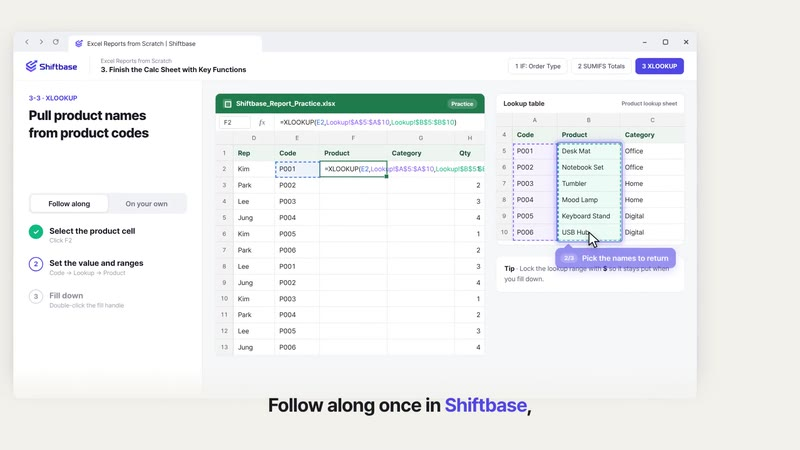
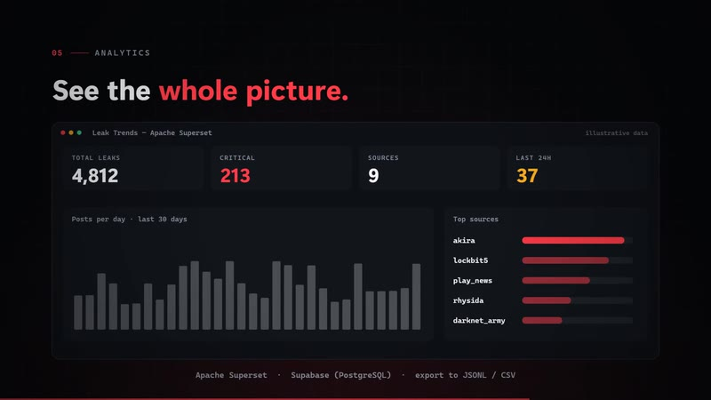

### Hi, I'm Heehyeon 👋

I'm a Tech Book Editor on the Learning Content team at **HanbitN**, where I plan and make books for the tech community. To truly understand the technologies I work with, I build working software myself.

From my time running the independent software studio [**Intbox**](https://intbox.org) to other personal builds, the projects below are tools built around how AI and security fit into everyday workflows.

More about me can be found at [**hhkb.dev**](https://hhkb.dev).

---

### Featured

<table>
<tr>
<td width="50%" valign="top">

<h4><a href="https://github.com/toumai266/Shiftbase">Shiftbase</a></h4>
<i>Hands-on training environment for workplace software and AI.</i> 
Users practice first inside a replica of the target program, then switch to their actual app with step-by-step guidance overlaid directly on the screen.
  Next.js · React · .NET / WPF · UI Automation
</td>
<td width="50%" valign="top">

<h4><a href="https://github.com/toumai266/Frontline">Frontline</a></h4>
<i>Browser-based stress testing for drone autonomy.</i> 
Combines quadrotor physics, seeded chaos, and batch experiments with confidence intervals to run reproducible, bit-for-bit identical tests across engines.
  Rust · WebAssembly · TypeScript · Three.js
</td>
</tr>
<tr>
<td width="50%" valign="top">

<h4><a href="https://github.com/toumai266/AgentSec-Twin">AgentSec Twin</a></h4>
<i>A digital twin for AI agent security.</i> 
Models agents, MCP servers, secrets, and policies as a single graph to simulate configuration changes and spot unintended access paths before deployment.
  Next.js · FastAPI · React Flow · Graph analysis
</td>
<td width="50%" valign="top">

<h4><a href="https://github.com/toumai266/Ship-or-Slop">Ship or Slop</a></h4>
<i>Multi-agent review for business ideas.</i> 
Multiple AI agents research, pitch, challenge, and revise an idea from different angles before voting on a final call: <b>Ship, Revise, or Slop.</b>
  Next.js · Supabase · Multi-model LLM routing
</td>
</tr>
<tr>
<td width="50%" valign="top">

<h4><a href="https://github.com/toumai266/Tracefield">Tracefield</a></h4>
<i>Regional change detection built on Sentinel-2 satellite imagery.</i> 
Turns open satellite data into grid-level insights, pairing map context with AI-generated analysis for each cell.
  FastAPI · Rasterio · MapLibre · OpenAI
</td>
<td width="50%" valign="top">

<h4><a href="https://github.com/toumai266/tricrawl">TriCrawl</a></h4>
<i>Dark web leak monitoring over Tor.</i> 
Tracks nine ransomware blogs and forums, deduplicates posts, scores entries against a watchlist, and sends alerts to Discord with charts in Superset.
  Python · Scrapy · Tor · Supabase · Superset
</td>
</tr>
<tr>
<td width="50%" valign="top">

<h4><a href="https://github.com/toumai266/Vibe-Audit">Vibe Audit</a></h4>
<i>Intent-drift monitor for coding agents.</i> (<code>npx vibe-audit</code>) 
Tracks Claude Code, Gemini CLI, and Codex sessions in real time, scoring each turn against your original prompt to catch when an agent goes off track.
  Python · FastAPI · React · LiteLLM · SQLite
</td>
<td width="50%" valign="top">

<h4><a href="https://github.com/toumai266/PurpleSim">PurpleSim</a></h4>
<i>Browser-based CVE attack and defense simulator.</i> 
Walk through a real CVE from both sides of the terminal—run the Red Team exploit chain first, then switch to the Blue Team to detect, contain, and patch it.
  Next.js · TypeScript · Zustand · Tailwind CSS
</td>
</tr>
</table>

---

### More

| Project | What it does |
| :--- | :--- |
| [**Mini ASM**](https://github.com/toumai266/Mini-ASM) | Attack surface workbench that discovers assets, enriches them with CVE/KEV/EPSS data, runs Nuclei checks, and tracks changes over time. |
| [**CAPE Noise Filter**](https://github.com/toumai266/CAPE-Intelligent-Noise-Filter) | Filters routine Windows background noise out of CAPE sandbox reports while keeping removed artifacts quarantined for review. |

---

### Tools I reach for

[hhkb.dev](https://hhkb.dev) · [intbox.org](https://intbox.org)
