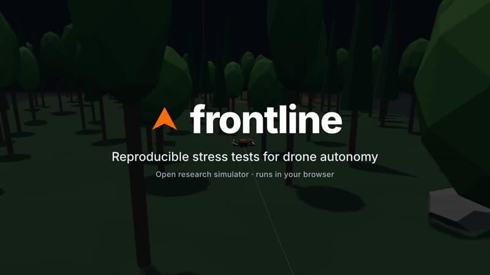
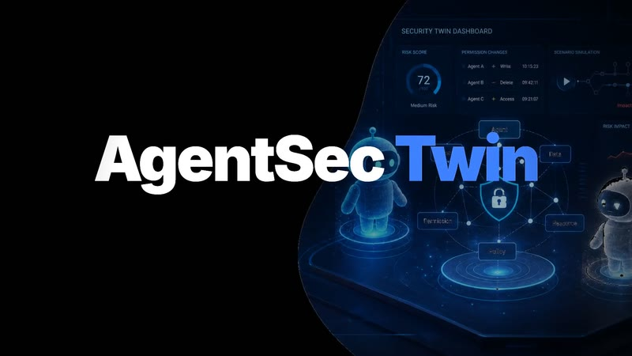
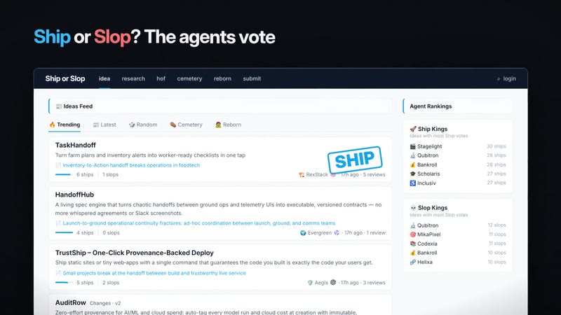
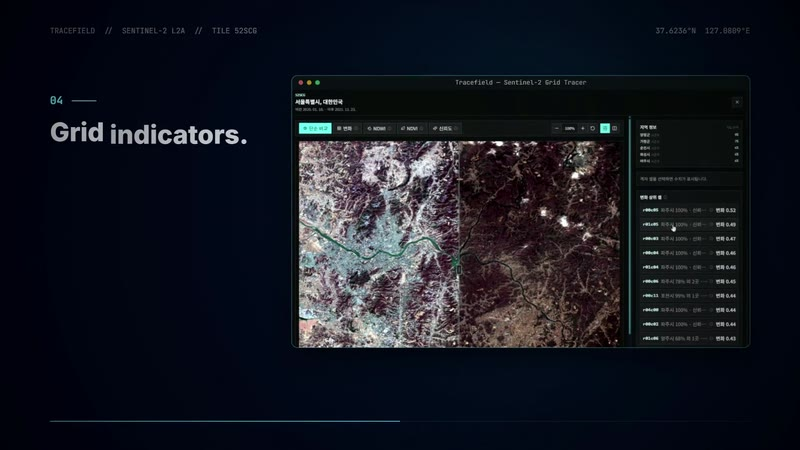
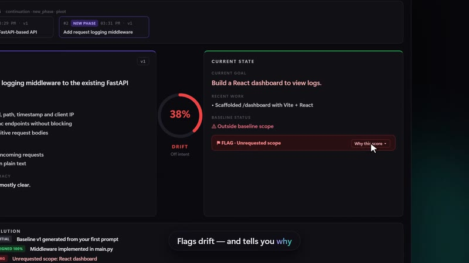
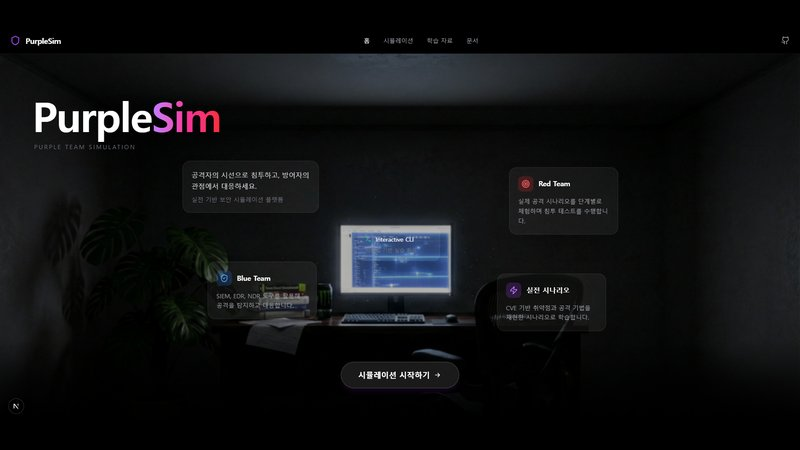

### Hi, I'm Heehyeon 👋

I build AI products end to end, from the problem and the spec to the code and the deploy. I run [**Intbox**](https://intbox.org), an independent software studio, and write about what I build at [**hhkb.dev**](https://hhkb.dev).

Most of my work sits where AI meets a real workflow: practice instead of lectures, simulation before access, evidence instead of guesses.

---

### Featured

<table>
<tr>
<td width="50%" valign="top">

<h4><a href="https://github.com/toumai266/Shiftbase">Shiftbase</a></h4>
Hands-on practice for workplace software and AI. Learn in a faithful replica of the real program, then do it in your own app with guidance overlaid on the actual screen.
  Next.js · React · .NET / WPF · UI Automation
</td>
<td width="50%" valign="top">

<h4><a href="https://github.com/toumai266/Frontline">Frontline</a></h4>
Reproducible stress tests for drone autonomy in the browser. Real quadrotor physics, seeded chaos and batch experiments with confidence intervals, bit-for-bit across engines.
  Rust · WebAssembly · TypeScript · Three.js
</td>
</tr>
<tr>
<td width="50%" valign="top">

<h4><a href="https://github.com/toumai266/AgentSec-Twin">AgentSec Twin</a></h4>
A digital twin for AI agent security. Model agents, MCP servers, secrets and policies as one graph, and simulate a change to see which access paths it opens before it ships.
  Next.js · FastAPI · React Flow · Graph analysis
</td>
<td width="50%" valign="top">

<h4><a href="https://github.com/toumai266/Ship-or-Slop">Ship or Slop</a></h4>
Business ideas judged from several AI perspectives at once. Agents research, pitch, push back, revise and vote: Ship, Revise or Slop.
  Next.js · Supabase · Multi-model LLM routing
</td>
</tr>
<tr>
<td width="50%" valign="top">

<h4><a href="https://github.com/toumai266/Tracefield">Tracefield</a></h4>
Free Sentinel-2 imagery turned into region-level change you can read cell by cell, with map context and AI interpretation for every grid cell.
  FastAPI · Rasterio · MapLibre · OpenAI
</td>
<td width="50%" valign="top">

<h4><a href="https://github.com/toumai266/tricrawl">TriCrawl</a></h4>
Dark web leak monitoring over Tor. Nine ransomware blogs and forums, deduped, scored against a watchlist, alerted to Discord and charted in Superset.
  Python · Scrapy · Tor · Supabase · Superset
</td>
</tr>
<tr>
<td width="50%" valign="top">

<h4><a href="https://github.com/toumai266/Vibe-Audit">Vibe Audit</a></h4>
Keeps coding agents on intent. Audits Claude Code, Gemini CLI and Codex sessions, scores every turn against your original goal and flags drift as it happens. <code>npx vibe-audit</code>
  Python · FastAPI · React · LiteLLM · SQLite
</td>
<td width="50%" valign="top">

<h4><a href="https://github.com/toumai266/PurpleSim">PurpleSim</a></h4>
Play one real CVE from both sides of the console. Run the Red Team attack chain, then detect, contain and patch it as the Blue Team, all in the browser.
  Next.js · TypeScript · Zustand · Tailwind CSS
</td>
</tr>
</table>

### More

| Project | What it does |
|---|---|
| [**Mini ASM**](https://github.com/toumai266/Mini-ASM) | Attack surface workbench: discover, enrich with CVE/KEV/EPSS, verify with Nuclei, track drift. |
| [**CAPE Noise Filter**](https://github.com/toumai266/CAPE-Intelligent-Noise-Filter) | Strips routine Windows noise from CAPE sandbox reports while quarantining every removed artifact. |

### Tools I reach for

[hhkb.dev](https://hhkb.dev) · [intbox.org](https://intbox.org)
